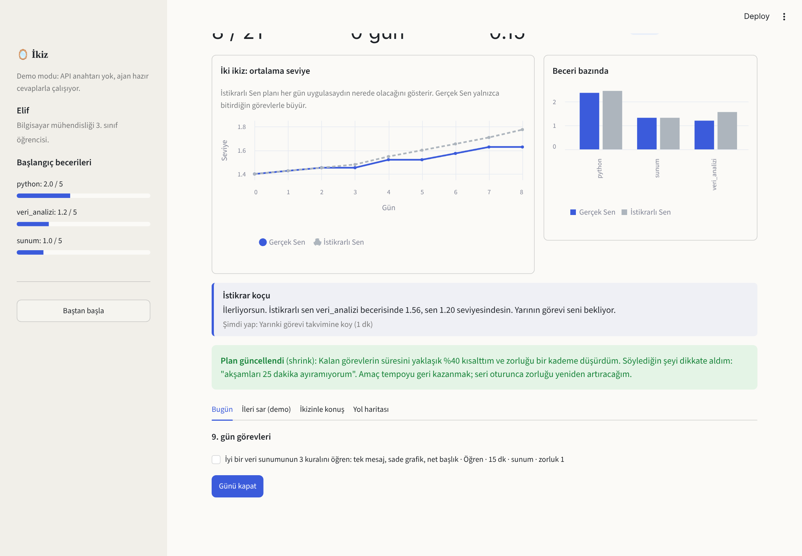
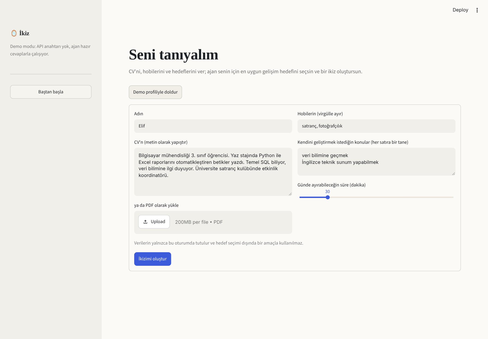
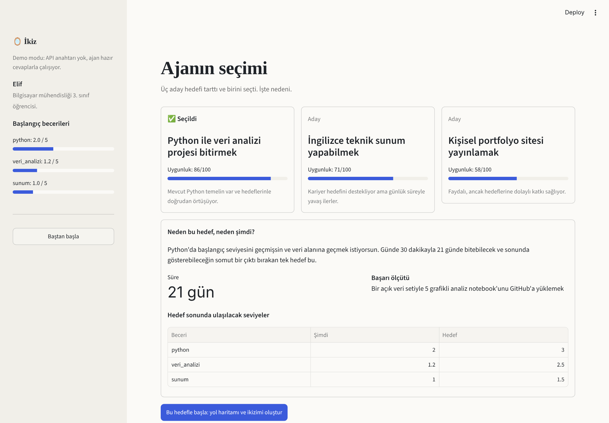
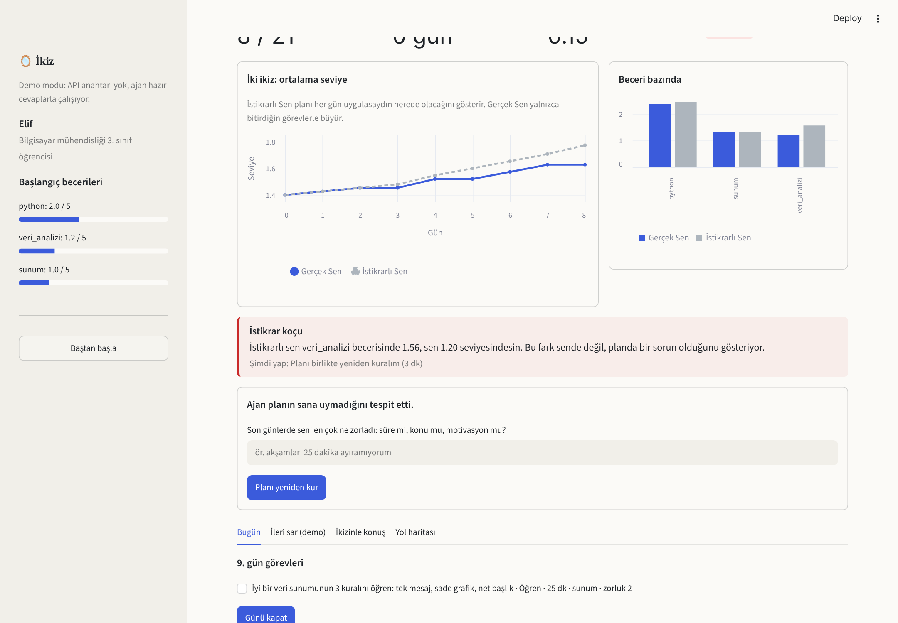
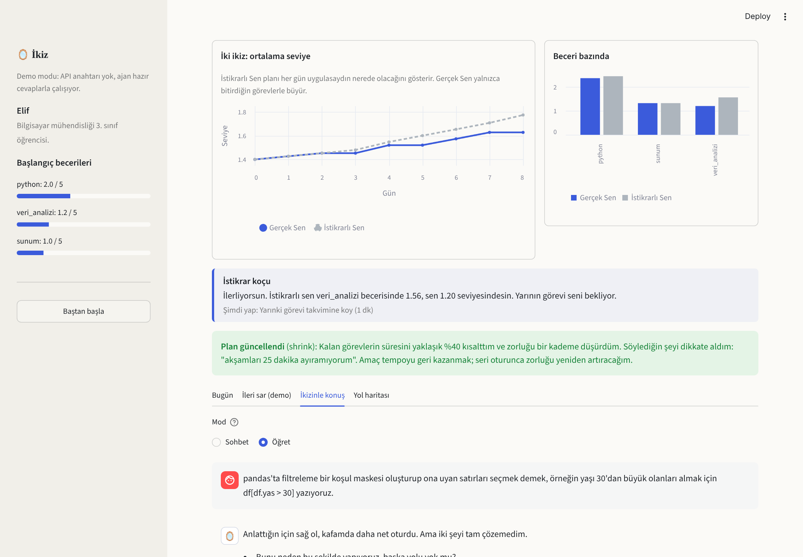

# 🪞 İkiz — seninle birlikte gelişen öğrenme ikizi

> **Agentic AI in Education** hackathon projesi

İkiz, kişisel gelişim hedefin için senin bir **dijital ikizini** oluşturur. Ajan CV'ni, hobilerini ve hedeflerini okur, sana en uygun **tek** hedefi gerekçesiyle seçer ve gün gün bir yol haritası kurar. Sonra iki ikiz yola çıkar:

- **İstikrarlı Sen:** planı her gün uygulasaydın nerede olacağın.
- **Gerçek Sen:** yalnızca gerçekten bitirdiğin görevlerle büyüyen ikizin.

Aradaki fark açıldığında ajan seni suçlamaz; **planı sorgular** ve kalan günleri kendi kararıyla yeniden düzenler. Öğretme görevlerinde ise öğrendiğini ikizine anlatırsın; o da meraklı bir akran gibi soru sorar ve anlatımını puanlar.



## Neden "agentic"?

İkiz tek seferlik bir sohbet botu değildir. Ajan, kullanıcının adım adım yönlendirmesine ihtiyaç duymadan şu kararları kendisi verir:

| Karar | Nerede |
|---|---|
| 3 aday hedef üretip puanlar, birini gerekçesiyle seçer | `select_goal` |
| Hedefi günlük süreye uyan görevlere böler, zorluğu kademeli artırır | `build_roadmap` |
| Her günün sonunda riski ölçer (momentum, dengeli, kayıyor, risk altında) | `advance_day` |
| Risk durumuna göre feedback stratejisini değiştirir | `coach_feedback` |
| Plan tutmadığında müdahale seçer (kısalt, sırala, uzat, tür değiştir, kapsam daralt) | `maybe_replan` |
| Kullanıcının seviyesinde kalan bir akran olarak öğretme anlatımını değerlendirir | `twin_talk` |

İkizlerin gelişimi bilerek **deterministik kodla** hesaplanır, LLM'e bırakılmaz. Böylece demo her seferinde tutarlı sonuç verir; LLM yalnızca karar ve dil üretir.

## Hızlı başlangıç

```bash
git clone <repo-url> && cd ikiz
pip install -r requirements.txt
streamlit run app.py
```

API anahtarı olmadan uygulama **demo modunda** çalışır: ajanlar hazır, gerçekçi cevaplar döndürür ve tüm akış uçtan uca denenebilir.

Gerçek modelle çalıştırmak için:

```bash
export ANTHROPIC_API_KEY=sk-ant-...
streamlit run app.py
```

## Ekranlar

| Seni tanıyalım | Ajanın seçimi |
|---|---|
|  |  |
| **Risk tespiti** | **İkizine öğret** |
|  |  |

## Proje yapısı

```
app.py            Streamlit arayüzü: onboarding → hedef kararı → ikiz paneli
ikiz_ajan.py      Veri şeması, ikiz gelişim mantığı, 6 ajan prompt'u, LLM çağrısı + demo mock'ları
DEMO.md           Jüri sunumu için 3 dakikalık demo senaryosu
docs/img/         Ekran görüntüleri
```

`ikiz_ajan.py` arayüzden bağımsızdır; tek başına çalıştırıldığında komut satırında bir simülasyon yapar:

```bash
python ikiz_ajan.py
```

## Pedagojik dayanak

- **Akran seviyesinde öğrenme arkadaşı:** İkiz, kullanıcıyla aynı seviyeden başlar ve onun hızında ilerler. Araştırmalar, akademik olarak zorlanan öğrencilerin düşük yetkinlikli bir öğrenme arkadaşıyla çalıştığında öz yeterliklerinin arttığını gösteriyor.
- **Öğreterek öğrenme:** Her 3-4 günde bir kullanıcı öğrendiğini ikizine anlatır. Bu görevler ikize %25 daha fazla gelişim kazandırır.
- **İstikrar odaklı geri bildirim:** Koç kullanıcıyı değil planı sorgular; seri bozulduğunda 5 dakikalık mini görevle geri dönüşü kolaylaştırır.

## Veri gizliliği

CV ve hedefler yalnızca oturum boyunca bellekte tutulur, diske yazılmaz. Gerçek modda yalnızca ajan çağrıları için model sağlayıcısına gönderilir. Üretim sürümünde KVKK kapsamında açık rıza ve veri silme akışı eklenmelidir.

## Yayına alma (canlı demo linki)

1. Repoyu GitHub'a gönder.
2. [share.streamlit.io](https://share.streamlit.io) üzerinden repoyu seç, ana dosya olarak `app.py`'yi ver.
3. Canlı mod istiyorsan **Secrets** bölümüne `ANTHROPIC_API_KEY = "..."` ekle. Eklemezsen uygulama demo modunda açılır.

## Sonraki adımlar

- Durumu kalıcı hale getirmek (SQLite veya Supabase) ve çok günlük gerçek kullanım
- Gerçek kaynak önerileri için web araması aracı
- Bildirimlerle proaktif hatırlatma
- Akran ikizleri: aynı hedefteki kullanıcıların ikizlerinin karşılaştırılması

## Lisans

MIT
